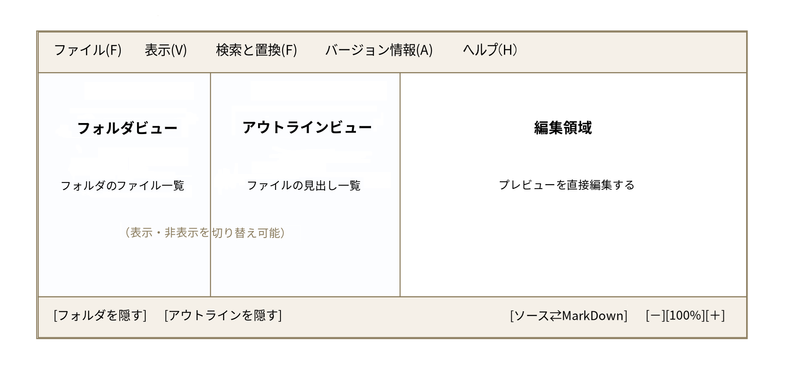

# mde（インライン編集に対応したシンプルなMarkdownエディタ）

日本語 | [英語](README.md)

mde は、Markdown ファイルをプレビューと同じ見た目のまま直接編集できる、Windows デスクトップ用の
Markdown エディタです。編集用とプレビュー用の画面が分かれていないので、書式が実際にどう見えるかを
確認しながらそのまま書き進められます。

このドキュメントは、mde を初めて使う方向けのガイドです。

## 目次

- [インストールと起動](#インストールと起動)
- [画面の見方](#画面の見方)
- [基本操作](#基本操作)
- [書式の書き方](#書式の書き方)
- [表（テーブル）](#表テーブル)
- [画像](#画像)
- [リンク](#リンク)
- [フォルダビュー](#フォルダビュー)
- [アウトラインビュー](#アウトラインビュー)
- [検索と置換](#検索と置換)
- [ソースモード](#ソースモード)
- [PDFへの書き出し](#pdfへの書き出し)
- [ショートカット一覧](#ショートカット一覧)
- [困ったときは](#困ったときは)
- [ライセンス](#ライセンス)

## インストールと起動

配布された `mde.msi` をダブルクリックすると、インストーラーが起動します。画面の案内に従って
進めると、インストールが完了します（すべてのユーザー向けにインストールされるため、Windowsから
確認のダイアログが表示された場合は許可してください）。

インストールが終わると、スタートメニューに「mde」が追加されます。ここから起動してください。

mde の実行には .NET 10 Desktop Runtime が必要です（同梱していません）。Windows 11環境の
多くは、会社のIT部門による配布や過去のWindows Updateなどで既に入っていることが多いですが、
万一入っていない場合は、mde を起動しようとした際に「.NETをインストールしてください」という
案内が自動的に表示され、そこから公式のダウンロードページへ進めます（mde 側で用意した画面
ではなく、.NET自体の標準機能です）。案内に従ってインストールした後、もう一度 mde を
起動してください。

初回起動時は空の新規ファイルが開いた状態になります。2回目以降は、ウィンドウのサイズ・位置や
表示倍率など、前回終了時の状態を記憶して復元します。

mde はコマンドライン引数でMarkdownファイルのパスを渡して起動すると、そのファイルを開いた
状態で立ち上がります。デスクトップのショートカットのリンク先（プロパティの「リンク先」欄）に
ファイルパスを追記しておけば、そのショートカットからワンクリックで特定のファイルを開けます。
なお、mde は現時点では `.md` ファイルの既定のアプリとしては登録されないため、エクスプローラーで
`.md` ファイルをダブルクリックしたり、タスクバーのアイコンへドラッグ&ドロップしたりしても
開けません（タスクバーアイコンへのドラッグはWindows側の仕様上そもそも動作しません）。

新しいバージョンの `mde.msi` を実行すると、既存のインストールが自動的に新しいバージョンへ
更新されます（アンインストールを先に行う必要はありません）。

アンインストールする場合は、Windowsの「設定」→「アプリ」（または「アプリと機能」）から
「mde」を選び、アンインストールしてください。

## 画面の見方



- **メニューバー**：ファイル操作、表示の設定、検索と置換、ヘルプ。
- **フォルダビュー**（左端）：開いているフォルダの中の Markdown ファイル一覧。
- **アウトラインビュー**（中央）：今開いているファイルの見出し一覧。クリックでその場所へジャンプします。
- **編集領域**（右側の大部分）：実際に文章を書く場所。ここに表示されている内容がそのまま保存されます。
- **ステータスバー**（下端）：ペインの表示切り替え、ソース⇄Markdown切り替え、表示倍率の調整。

フォルダビュー・アウトラインビュー・ステータスバーは、最初は表示されていません。メニュー「表示」→
「フォルダを表示」「アウトラインを表示」「ステータスバーを表示」で、それぞれ独立に表示・非表示を切り替えられます
（ステータスバー左側のボタンでも切り替えられます。ペインの幅は境界をドラッグして調整します）。
新しいウィンドウ（新規作成・別のファイルを開く等）は、開いた元のウィンドウと同じ表示・非表示の状態で開きます。
「フォルダを開く…」でフォルダを開いた時は、フォルダビューを必ず表示します。

## 基本操作

| 操作 | 方法 |
|---|---|
| 新規作成 | メニュー「ファイル」→「新規作成」、または `Ctrl+N`（新しいウィンドウを開きます。今のウィンドウの内容はそのまま残ります） |
| ファイルを開く | メニュー「ファイル」→「開く…」、または `Ctrl+O` |
| 最近使ったファイルを開く | メニュー「ファイル」→「最近使ったファイル」から選択 |
| 最近使ったフォルダを開く | メニュー「ファイル」→「最近使ったフォルダ」から選択 |
| フォルダを開く | メニュー「ファイル」→「フォルダを開く…」、またはフォルダビューの「…」ボタン |
| 上書き保存 | メニュー「ファイル」→「保存」、または `Ctrl+S` |
| 名前を付けて保存 | メニュー「ファイル」→「名前を付けて保存…」、または `Shift+Ctrl+S` |
| すべて保存 | メニュー「ファイル」→「すべて保存」（フォルダ全体の変更をまとめて書き出す） |
| ウィンドウを閉じる | メニュー「ファイル」→「閉じる」、または `Ctrl+W` |
| 拡大・縮小 | メニュー「表示」→「拡大」「縮小」「100%に戻す」、ステータスバーの「－」「＋」ボタン、`Ctrl++`・`Ctrl+-`・`Ctrl+0`、または `Ctrl+マウスホイール`（倍率は 48%・57%・69%・83%・100%・120%・144%・172%・207%・248% から選びます） |
| ステータスバーの表示 | メニュー「表示」→「ステータスバーを表示」 |
| 文字の色 | メニュー「表示」→「文字の色」（「くっきりした色」・「目にやさしい色」） |
| 表示スタイル | メニュー「表示」→「表示スタイル」（「GitHubスタイル」・「VSCodeスタイル」）。切り替えても、表示している場所はそのままです |
| 画面の言語 | メニュー「表示」→「言語」（「日本語」・「English」）。最初は Windows の表示言語に合わせます（日本語以外は英語）。一度切り替えると、次回からはその言語で起動します。「ヘルプ」→「Readmeを開く」（`F1`）は、画面の言語の README（この文書、または英語版）を開きます |
| 本文の幅 | メニュー「表示」→「本文の幅」（「読みやすい幅にする（最大 884px）」：本文を最大 884px の幅で中央に置く（mdew・mdee と同じ）・「編集ペインの幅に合わせる」：編集ペインの幅いっぱいに表示する（既定）） |

未保存の変更がある状態でファイルを閉じよう・切り替えようとすると、保存するかどうかの確認が
表示されます。ウィンドウを閉じる時は「…は変更されています。閉じる前に保存しますか？」と表示され、
「はい」で保存してから閉じ、「いいえ」で保存せずに閉じ、「キャンセル」で閉じるのをやめます。

文字の色は、メニュー「表示」→「文字の色」で切り替えられます。「くっきりした色」（黒）と、
少し薄い灰色で線が細く見える「目にやさしい色」（既定。リンクも少し薄い青になります）があります。
切り替えは次回起動時も同じになります。

文書の見た目は、メニュー「表示」→「表示スタイル」で切り替えられます。「GitHubスタイル」（既定。今までの見た目）と、
Visual Studio Code のプレビューに似せた「VSCodeスタイル」（文字は Segoe UI・Yu Gothic UI の少し小さめの字、
見出しは少し細い太字、箇条書きは項目の間を空けない、リンクは下線なし、インラインコードは赤い字、
表は縦の線なし）があります。切り替えは次回起動時も同じになります。

メニュー「ファイル」→「最近使ったファイル」には、最近開いたファイルが新しい順にフルパスで一覧表示され、
クリックするとそのファイルを開けます。ファイルが移動・削除されている場合はその旨が表示され、
一覧からも自動的に取り除かれます。「履歴をクリア」で一覧を空にできます。
mde で開いたファイルは、Windows の「最近使ったもの」にも登録され、タスクバーの mde のアイコンを右クリックした時の
一覧（「最近使ったもの」）や、エクスプローラーの「最近使ったファイル」にも表示されます。

メニュー「ファイル」→「最近使ったフォルダ」には、「フォルダを開く…」（またはフォルダビューの「…」ボタン）で
開いたフォルダが、新しい順にフルパスで一覧表示されます。クリックすると、そのフォルダをフォルダビューに開きます。

「最近使ったファイル」「最近使ったフォルダ」の一覧は、クリックするか、マウスを乗せて少し待つと開きます
（マウスを通り過ぎるだけなら開かないので、長い一覧がほかのメニューの項目を隠してしまうことはありません）。

メニューの「開く…」（`Ctrl+O`）「最近使ったファイル」「フォルダを開く…」「最近使ったフォルダ」は、今のウィンドウで
ファイルやフォルダを開いている時や、何か書いてある時は、新しいウィンドウで開きます（今のウィンドウの内容は
そのまま残ります）。何も書いていない新しいウィンドウでは、そのウィンドウで開きます。今のウィンドウで開いている
ファイル・フォルダそのものを選んだ時は、新しいウィンドウは開きません。フォルダビューの「…」ボタンは、今までどおり
このウィンドウのフォルダを切り替えます。

### 編集していない部分はそのまま保存される

mde は、見出し・段落・箇条書き・表・コードブロックといったまとまり（ブロック）ごとに、
実際に編集したブロックだけを保存時に書き直します。触っていない部分は、読み込んだ時の
書き方（余白や改行の位置など）がそのまま保たれます。そのため、開いて保存しただけで
差分だらけになる、といったことが起きにくくなっています。

## 書式の書き方

編集領域に直接、見た目そのままで書式が反映されます。

| 書きたいもの | 入力方法 |
|---|---|
| 見出し | 行頭で `#` に続けてスペース（`#`〜`######` で見出し1〜6） |
| 引用 | 行頭で `> ` に続けてスペース |
| 太字 | `**太字にしたい文字**` |
| 斜体 | `*斜体にしたい文字*` または `_斜体にしたい文字_` |
| 取り消し線 | `~~取り消し線にしたい文字~~` |
| 下線 | `<u>下線を引きたい文字</u>` |
| ハイライト | `==ハイライトしたい文字==` |
| インラインコード | `` `コードにしたい文字` `` |
| 箇条書き | 行頭で `* ` または `- ` に続けて入力 |
| 番号付きリスト | 行頭で `1. ` のように数字＋ピリオド＋スペース |
| タスクリスト（チェックボックス） | 箇条書き項目の先頭、または表のセル（見出しの行以外）の先頭で `[ ] `（未チェック）または `[x] `（チェック済み）に続けて入力（表のセルでは、後ろのスペースは無くてもよい） |
| 水平線 | `---`・`***`・`___` のいずれかを3個以上、間にスペースを挟まず並べてEnter |
| コードブロック | 行頭で `` ``` `` （言語名を続けてもよい：`` ```csharp ``）と入力してEnter |
| リンク | `[表示文字](URL)` または `<https://...>` |
| メールアドレスの自動リンク | `<name@example.com>` |

これらの記号は、閉じ側の記号を打ち終えた瞬間に自動的に見た目の書式へ変換されます
（後から記号を挿入した場合も同様です）。保存時には元のMarkdown記法に戻ります。

文字を選択した状態で右クリックすると、メニューの「太字」「斜体」「下線」「取り消し線」「インラインコード」
「ハイライト」で書式を設定・解除できます（mdew と同じ）。今付いている書式には ✓ が付き、選ぶと付ける・外すが
切り替わります。書式は重ねて付けられます（太字の取り消し線など。Markdown では `~~**文字**~~` のように書かれます）。
インラインコードには、ほかの書式を重ねられません（Markdown ではコードの中に書式を書けないため。今の選択範囲に
付けられない項目は灰色になります）。「通常表記に戻す」で、すべての書式を外せます。文字を選択して **Ctrl+B**（太字）・**Ctrl+I**（斜体）・
**Ctrl+U**（下線）・**Alt+Shift+5**（取り消し線）・**Ctrl+Shift+@**（インラインコード）を押しても同じように
切り替えられます（mdew と同じキー）。段落やブロック単位の
書式変更（見出しレベルの変更など）も右クリックメニューから行えます。

右クリック→「ページトップに戻る」で、文書の先頭を表示します（カーソルも先頭に移ります）。ソースモードでも使えます。

### 箇条書き・リストの操作

- 項目の途中で **Enter**：次の項目を追加
- 項目の途中で **Shift+Enter**：項目の中で改行（新しい項目にはならない）
- **Tab**：字下げ（入れ子のリストにする）
- **Shift+Tab**：字下げを解除
- 空の項目で **Enter を2回**：リストから抜ける

リストが何段にも入れ子になっている場合も、行頭の記号は既定ではすべての段で「・」で表示されます。
メニュー「表示」→「箇条書きの記号」→「WPF標準」に切り替えると、1段目が「・」、2段目が「○」、
3段目以降は「■」で表示されます。

### タスクリスト（チェックボックス）

箇条書き項目の先頭で `[ ] ` または `[x] ` と入力すると、チェックボックス付きの項目に
変換されます。表示されたチェックボックスはクリックでチェック⇔未チェックを切り替えられます。

チェックボックス項目の途中で **Enter** を押すと、次の行にも続けてチェックボックス付きの
項目が作られます。文字を何も入力していないチェックボックス項目で Enter を押すと、通常の
空の箇条書き項目と同様にリストから抜けます。

表のセル（見出しの行以外）の先頭で `[ ]` または `[x]` と入力しても（後ろのスペースは無くてもかまいません）、
チェックボックスに変換されます（ファイルには、セルの先頭の `[ ]`・`[x]` として保存されます。GitHub 等の他のアプリでは、`[ ]` の文字のまま
表示されます）。

### コードブロックの操作

コードブロックの中では Enter キーは改行として働きます（新しい項目やコードブロックの終了には
なりません）。**Tab** でタブ文字を挿入、**Shift+Tab** で行頭のインデントを1段階戻せます。
コードブロックから抜けるには、上下の行をクリックしてください。

コードブロックの上で右クリック→「コードブロック全体をコピー（```込み）」を選ぶと、開始・終了の
`` ``` `` と言語名を含めた完全なMarkdown形式でコピーできます（他のMarkdown文書やチャットへの
貼り付け用）。

### 引用の操作

引用の中では Enter キーは、コードブロックと同じく常に同じ引用の中での改行として働きます
（新しい項目や引用の終了にはなりません）。引用から抜けるには、上下の行をクリックして
ください。

引用の先頭行が空の状態で BackSpace を押すと、引用を解除して通常の段落に戻ります
（見出しと同様の挙動です）。

### 段落中の改行

ソースの1行の終わり（空行を伴わない、単純な改行）をどう表示するかは、メニュー「表示」→
「段落中の改行」で選べます。既定は「空行が入るまで改行しない」で、空行を挟まない改行は
単なる空白として扱われ、段落は画面幅で折り返して表示されるまで改行されません（VSCodeの
Markdownプレビューと同じ動作です）。「ソースの通りに改行する」に切り替えると、ソースの改行が
そのまま見た目の改行になります。画像だけの行は、どちらの設定でも、前後の行とつなげずに
その行だけで表示します。

段落の途中で **Shift+Enter** を押すと、上記の設定に関わらず、必ずその場で改行された見た目に
なります（Markdown上は `<br>` として保存されます）。

### 空の行（続いた空行）

ブロックの間の空行が3つ以上続いている所は空の行を置いて間を空けて表示します。
箇条書きの項目の間も同じです。
GitHub などほかのアプリでは、空行がいくつ続いても、段落の区切り1つとして表示されます。

## 表（テーブル）

右クリックメニューの「表を挿入」から、行数・列数を指定して表を作成できます。作成後は、
表の中にカーソルがある状態で右クリックすると、行・列の挿入や削除、表全体の削除ができます。
セル間の移動には矢印キーが使えます。**Tab** で次のセル、**Shift+Tab** で前のセルへ移動します
（移動先のセルの文字が選択されます）。最後のセルで **Tab** を押すと、下に行が追加されます。
**Ctrl+Enter** で、今の行の下に行を追加します。

### 列幅の自動調整・手動調整

表の列幅は、既定では内容量に応じて自動的に調整されます。ウインドウの表示幅に余裕がある
場合は各列の内容がちょうど収まる幅で、余裕がない場合は、各列の内容量に応じて幅を分けて表示されます
（mdew・mdee の「編集ペインの幅に合わせる」と同じく、ブラウザの表と同じ計算です。長い語・URLは途中で折り返します）。表の中を編集して
カーソルが表の外へ出た時にも、内容に合わせて列幅を調整し直します。

列幅を自分で指定したい場合は、表の中で右クリック→「列幅を調整…」を選びます。開いた
ダイアログで、各列の幅を他の列との比率を表す数値（3以上）で指定できます。表全体は、
編集領域の横幅に収まるようにこの比率で分け合われます。「自動計算」のチェックを外すと
指定した比率がそのまま使われ、数値を直接編集すると自動的にオフになります。

### 他のアプリからの貼り付け

- Claude 等のチャット・Webページ・Word・Googleドキュメントでコピーした書式付きの内容を貼り付けると、
  見出し・箇条書き・番号付きリスト・表・コードブロック・引用・太字・斜体・リンク等が、mde の書式に
  なります（文字の色・大きさ等の飾りは取り除かれます。mdew と同じ）。
- Markdown の文字（メモ帳・VS Code 等でコピーしたもの）を貼り付けると、見出し・リスト・表・
  コードブロック等も書式になります。1つの段落だけの場合は、これまで通り今の段落の中に挿入されます。
  表のセル・引用の中など、見出しやリストを置けない場所では、文字として挿入されます。
- **Ctrl+Shift+V** で、Markdown の記号を書式にせず、文字のまま貼り付けます（書式なしで貼り付け）。

### Excelとの連携

- Excelで選択した範囲をコピーして mde に貼り付けると、そのまま罫線付きの表になります。
- mde の表を選択してコピーし、Excelに貼り付けると、Excelのセルに展開されます。
- 表の一部だけを選択してコピーした場合は、その範囲だけが正確にコピーされます。表全体を
  コピーしたい場合は、表全体をドラッグして選択するか、右クリックメニューの「表を削除」の
  下にある「表をコピー」を使うと、選択操作なしで確実に表全体をコピーできます。
- 別のmdeウィンドウなど、他のMarkdown対応アプリとの間でも、罫線を保ったまま表としてコピー＆
  ペーストできます。タブ区切りテキストの貼り付けにも対応しています。
- 表以外の部分（見出し・段落・箇条書き・タスクリスト・コードブロック・画像等）を選択して
  コピーし、Excelに貼り付けると、太字・取り消し線・下線・ハイライト・リンク等の書式を保った
  まま、見出しや段落、箇条書きの項目ごとに1行として展開されます。箇条書きの記号やタスク
  リストのチェック状態は「・」「1.」「☑」「☐」等の文字として先頭に付きます（Excelのセルには
  本物の箇条書き記号やチェックボックスを置けないため）。1つの段落・見出しの一部分だけを
  選択した場合（単語の一部を選んだ場合など）は対象外です。段落全体、または複数の段落に
  またがる範囲を選択してください。
- 選択範囲に画像が含まれる場合は、Excelのセルへ画像として埋め込まれます（Excelのバージョン・
  設定によっては正しく貼り付けられない場合があります）。埋め込めなかった場合は「[画像]」の
  文字列になります。画像は一時的なファイルとして書き出す方式のため、コピーしたらなるべく
  早めに貼り付けてください（しばらく経つと一時ファイルが自動的に整理され、貼り付けられなく
  なることがあります）。
- 見出しや段落と表が混在する範囲（表を含めてまとめて選択した場合など）をコピーした場合も、
  表の部分はその表自身の行として、それ以外の部分は1項目1行として、まとめてExcelへ展開
  されます。

## 画像

「開く…」でファイルを選んだとき、またはフォルダビューでファイルをクリックしたときは、
同じフォルダにある画像が自動的に解決されて表示されます。

エディタに画像ファイルをドラッグ&ドロップすると、ドロップした位置に画像として挿入されます。
挿入した画像は、**保存するまでの間は一時フォルダに置かれ、実際のファイルには反映されません**。
保存すると、画像は編集中のファイルと同じフォルダの `images` フォルダへ自動的に移動されます
（同名ファイルがある場合は連番を付けて重複を回避します）。保存せずに変更を破棄すれば、
画像を追加する前の状態に戻ります。

画像はエディタの表示幅を超える場合のみ自動的に縮小されます。画像をダブルクリックするか、
右クリック→「画像を開く」を選ぶと、Windowsで関連付けられた既定のアプリ（フォトなど）で
その画像を開けます。右クリック→「画像を保存…」で、任意の場所に画像ファイルとして保存
できます（デスクトップなどへ直接ドラッグ&ドロップして書き出すこともできます）。右クリック→
「画像を削除」で、その画像を文書から削除できます。

画像の表示の大きさは、右クリック→「画像のサイズ」で、元の画像の大きさに対する割合（25%〜200%）で
変えられます。大きさは `` のように `width` で保存
されるので、GitHub・VS Code のプレビューでも同じ大きさで表示されます。「100%（元のサイズ）」を
選ぶと大きさの指定を外し、元の `` の形に戻します。HTML のタグで書いた画像の
`width`・`height` で大きさを変えた画像（`style="zoom:50%;"`）も、その大きさで表示します。

画像は、元の画像の 1 ピクセルを画面の 1 ピクセル分（Windows の拡大率が 150% なら 1.5 ピクセル分）の
大きさで表示します（GitHub・ブラウザーと同じ）。拡大率を上げた画面で撮ったスクリーンショットは、
元の見た目より大きく表示されるので、「画像のサイズ」で小さくしてください。

## リンク

`[表示文字](URL)` の形式、または `<https://...>` の山括弧形式の両方に対応しています。
メールアドレスは `<name@example.com>` の形式で自動的にリンクになります（`mailto:` 付き）。
文中にそのまま書いたメールアドレス（`name@example.com`）も、mailto のリンクとして表示されます（GitHub と同じ。
ファイルには書いたまま、`< >` を付けずに保存されます）。入力した時は、後ろに空白・句読点等を打つか、Enter を
押した時にリンクになります。
リンクは青字＋下線で表示され、既定ではクリックで開きます。マウスを乗せるとURLが
ツールチップで表示されます。

メニュー「表示」→「リンクの開き方」で、「Ctrl+クリックで開く」に切り替えることもできます
（Ctrlを押さずにクリックした場合は、通常どおりカーソルが移動するだけになります）。

ほかのファイルへのリンク（`[説明](other.md)` のような相対パス）は、新しいウィンドウでそのファイルを開きます
（今のウィンドウの内容はそのまま残ります）。ただし、フォルダビューを表示していて、リンク先がフォルダビューに
表示しているフォルダの中にある時は、フォルダビューでファイルをクリックした時と同じく、今のウィンドウで開きます。
今開いているファイル自身への `#見出し` 付きのリンクは、その見出しへ移動します。
Markdown 以外のファイル（`LICENSE.txt`・PDF・画像等）へのリンクは、mde では開かず、Windows でそのファイルに
関連付けられたアプリで開きます（プログラム（`.exe`・`.bat` 等）へのリンクは、実行するかどうか確認します）。

リンクの上で右クリックすると、「リンクを開く」「URLをコピー」「リンクを編集…」
「リンクを解除」を選べます。文字を選択して右クリック→「リンクにする…」でも
リンクを設定できます。

## フォルダビュー

左端のフォルダビューでは、開いているフォルダの中のMarkdownファイルが一覧表示されます。
ファイルをクリックすると、そのファイルが編集領域に開きます。フォルダアイコンをクリックすると
展開・折りたたみができます。

保存されていない変更があるファイルは、ファイル名の先頭に `*` が表示されます。フォルダを
切り替える際、`*` の付いたファイルが残っていると、破棄してよいか確認されます。

フォルダビューの一番上にある「…」ボタン、またはメニュー「ファイル」→「フォルダを開く…」から、
別のフォルダを開き直せます。以前開いたフォルダは、メニュー「ファイル」→「最近使ったフォルダ」から
選んで開き直すこともできます。フォルダビューを隠していた場合は、フォルダを開くと表示されます。

## アウトラインビュー

中央のアウトラインビューには、今開いているファイルの見出しが階層付きで一覧表示されます。
見出しをクリックすると、編集領域内のその位置までジャンプします。長い文書で目的の場所を
すぐに見つけたいときに便利です。

## 検索と置換

メニュー「検索と置換」（または `Ctrl+F`）で検索と置換ウィンドウを開きます。文字列を範囲選択してから開くと、
その文字列が検索する文字列に入ります（複数行にまたがる選択の時は入りません）。

- **対象範囲**：「現在のファイル」か「フォルダ全体（サブフォルダ含む）」を選べます。
- **大文字・小文字を区別する** / **正規表現を使用する**：それぞれチェックボックスで切り替え
  （正規表現の置換後文字列では `$1` などの後方参照が使えます）。
- **前を検索 / 次を検索**：一致箇所を1つずつ移動しながら確認します。
- **すべて検索**：一致箇所をまとめて一覧表示し、強調表示します。フォルダ全体を対象にした場合は
  ファイルの一覧が表示され、ダブルクリックでそのファイルを開いてジャンプできます。
- **1件ずつ置換…**：一致箇所を1つずつ確認しながら「置換」「スキップ」「残りをすべて置換」を
  選べます。

フォルダ全体を対象にした置換は、**保存するまで実際のファイルには反映されません**
（アプリ内で保持されるだけです）。ファイル名の一覧やフォルダビューには `*` が付くので、
メニュー「ファイル」→「すべて保存」でまとめて書き出してください。

検索条件（検索語・対象範囲・オプション）は、ウィンドウを閉じても次回開いたときに引き継がれます。

## ソースモード

ステータスバーの「ソース⇄Markdown」ボタン、または右クリックメニューから、Markdownのソース
テキストをそのまま編集するモードに切り替えられます。書式を気にせずテキストとして一括編集したい
ときに使えます。

## PDFへの書き出し

メニュー「ファイル」→「PDFに書き出し…」（`Ctrl+P`）で、現在編集中の内容をPDFとして書き出せます。
Windows標準の「Microsoft Print to PDF」仮想プリンタを使って書き出す方式のため、追加の
ソフトウェアのインストールやインターネット接続は不要です。

- PDFへの書き出しは **Markdownモードでのみ**利用できます。ソースモードのときは、先に
  ステータスバーの「ソース⇄Markdown」ボタンでMarkdownモードへ切り替えてください。
- 印刷ダイアログでプリンタとして「Microsoft Print to PDF」を選ぶと、PDFの保存先を
  聞かれます。最初は編集中のファイルと同じフォルダが開き、ファイル名には編集中の
  ファイル名（拡張子を `.pdf` に変えたもの）が入っています。
- ページの余白は、メニュー「ファイル」→「PDFの余白を設定…」で上下左右をそれぞれ
  指定できます（既定は上下64px、左右80px）。

## ショートカット一覧

| キー | 動作 |
|---|---|
| `Ctrl+N` | 新規作成（新しいウィンドウ） |
| `Ctrl+O` | 開く… |
| `Ctrl+S` | 保存 |
| `Shift+Ctrl+S` | 名前を付けて保存… |
| `Ctrl+P` | PDFに書き出し… |
| `Ctrl+W` | ウィンドウを閉じる |
| `F1` | Readmeを開く（この文書） |
| `Ctrl+F` | 検索と置換 |
| `Ctrl+B` / `Ctrl+I` / `Ctrl+U` | 選択した文字を太字 / 斜体 / 下線にする（もう一度押すと解除） |
| `Alt+Shift+5` / `Ctrl+Shift+@` | 選択した文字を取り消し線 / インラインコードにする（もう一度押すと解除） |
| `Ctrl+Shift+V` | 書式なしで貼り付け |
| `Ctrl+Z` | 元に戻す |
| `Ctrl+Y` | やり直し |
| `Ctrl+←` | 1つ前に開いていたファイルを開く |
| `Ctrl+→` | 1つ後に開いていたファイルを開く |
| `Ctrl++` / `Ctrl+-` / `Ctrl+0` | 拡大 / 縮小 / 表示倍率を100%に戻す（日本語キーボードの `Ctrl+;` も拡大） |
| `Ctrl+マウスホイール` | 拡大・縮小 |
| `Ctrl+クリック`（リンク上） | リンクを開く |
| `Tab` / `Shift+Tab`（リスト・コードブロック内） | 字下げ／字下げ解除 |
| `Tab` / `Shift+Tab`（表の中） | 次のセル／前のセルへ移動（最後のセルの `Tab` は行を追加） |
| `Ctrl+Enter`（表の中） | 下に行を追加 |

## 困ったときは

- 動作がおかしいと感じたときは、一度ファイルを保存してからウィンドウを閉じて開き直してみてください。
- 起動時の状態やペインの幅などがおかしくなった場合は、`%AppData%\mde\settings.json` を削除すると
  初期状態に戻ります。

## ライセンス

mde は MIT License です（`LICENSE.txt`）。ただし、インストーラーのソースの `msi\UpgradeConfirmDlg.wxs` は、
WiX Toolset の `WixUI_Minimal.wxs` を元に作ったものなので、Microsoft Reciprocal License（MS-RL）です
（`msi\LICENSE-MS-RL.txt`）。