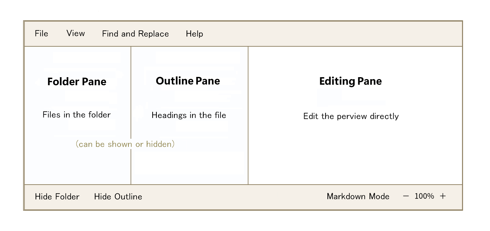

# mde (a simple Markdown editor with inline editing)

English | [Japanese](README.ja.md)

mde is a Markdown editor for the Windows desktop that lets you edit Markdown files directly, in the same look as
the preview. There is no separate editing screen and preview screen, so you can keep writing while you see how
the formatting actually looks.

This document is a guide for people who are new to mde.

## Contents

- [Installing and starting mde](#installing-and-starting-mde)
- [The screen](#the-screen)
- [Basic operations](#basic-operations)
- [Formatting](#formatting)
- [Tables](#tables)
- [Images](#images)
- [Links](#links)
- [Folder view](#folder-view)
- [Outline view](#outline-view)
- [Find and replace](#find-and-replace)
- [Source mode](#source-mode)
- [Exporting to PDF](#exporting-to-pdf)
- [Keyboard shortcuts](#keyboard-shortcuts)
- [Troubleshooting](#troubleshooting)
- [License](#license)

## Installing and starting mde

Double-click the `mde.msi` file you received to start the installer. Follow the steps on the screen to finish
the installation (mde is installed for all users, so if Windows asks for permission, allow it).

When the installation is finished, "mde" is added to the Start menu. Start mde from there.

mde needs the .NET 10 Desktop Runtime (it is not included). Many Windows 11 PCs already have it, installed by
the company's IT department or by an earlier Windows Update. If it is missing, a message asking you to install
.NET appears automatically when you start mde, and it takes you to the official download page (this is a
standard feature of .NET itself, not a screen made by mde). Install it as instructed, then start mde again.

The first time you start mde, an empty new file is open. From then on, mde remembers the state when you last
closed it, such as the window size and position and the zoom level, and restores it.

If you start mde with the path of a Markdown file as a command-line argument, mde opens that file. If you add
a file path to the target of a desktop shortcut (the "Target" box in its properties), you can open that file
from the shortcut with one click.
mde is not registered as the default app for `.md` files at this time, so double-clicking a `.md` file in File
Explorer, or dragging it onto the taskbar icon, does not open it in mde (dragging onto a taskbar icon does not
work at all, because of how Windows works).

Running a newer `mde.msi` updates the existing installation to the new version automatically (you do not need
to uninstall it first).

To uninstall mde, choose "mde" in Windows "Settings" → "Apps" (or "Apps & features") and uninstall it.

## The screen



- **Menu bar**: file operations, view settings, find and replace, and help.
- **Folder view** (left): the list of Markdown files in the open folder.
- **Outline view** (middle): the list of headings in the open file. Click a heading to jump to it.
- **Editing area** (most of the right side): where you write. What you see here is what is saved.
- **Status bar** (bottom): buttons to show or hide the panes, switch between source mode and Markdown mode,
  and change the zoom level.

The folder view, the outline view, and the status bar are hidden at first. You can show or hide each of them
with "View" → "Show Folder", "Show Outline", and "Show Status Bar" (you can also use the buttons on the left of
the status bar; drag the border of a pane to change its width).
A new window (from New, opening another file, etc.) opens with the panes shown or hidden in the same way as
the window it was opened from. When you open a folder with "Open Folder…", the folder view is always shown.

## Basic operations

| Operation | How |
|---|---|
| New | "File" → "New", or `Ctrl+N` (a new window opens; the current window stays as it is) |
| Open a file | "File" → "Open…", or `Ctrl+O` |
| Open a recent file | Choose it from "File" → "Recent Files" |
| Open a recent folder | Choose it from "File" → "Recent Folders" |
| Open a folder | "File" → "Open Folder…", or the "…" button in the folder view |
| Save | "File" → "Save", or `Ctrl+S` |
| Save as | "File" → "Save As…", or `Shift+Ctrl+S` |
| Save all | "File" → "Save All" (writes all the changes in the folder at once) |
| Close the window | "File" → "Close", or `Ctrl+W` |
| Zoom in / out | "View" → "Zoom In", "Zoom Out", "Reset to 100%", the "－" and "＋" buttons on the status bar, `Ctrl++`, `Ctrl+-`, `Ctrl+0`, or `Ctrl+mouse wheel` (the zoom level is one of 48%, 57%, 69%, 83%, 100%, 120%, 144%, 172%, 207%, and 248%) |
| Show the status bar | "View" → "Show Status Bar" |
| Text color | "View" → "Text Color" ("High Contrast" or "Easy on the Eyes") |
| Display style | "View" → "Display Style" ("GitHub Style" or "VS Code Style"). The part of the document you are looking at stays in view when you switch |
| Language | "View" → "Language" ("日本語" or "English"). At first, mde follows the Windows display language (English unless it is Japanese). Once you switch, mde starts in that language from then on. "Help" → "Open Readme" (`F1`) opens the README in the language of the screen (this document or the Japanese version) |
| Text width | "View" → "Text Width" ("Readable Width (Max 884px)": the text is placed in the center at most 884px wide (the same as mdew and mdee); "Fit to Editor Pane": the text fills the width of the editor pane (default)) |

If you try to close or switch a file that has unsaved changes, mde asks whether to save it. When you close a
window, "… has been modified. Save before closing?" appears: "Yes" saves and closes, "No" closes without
saving, and "Cancel" keeps the window open.

You can change the text color with "View" → "Text Color": "High Contrast" (black) or "Easy on the Eyes"
(default; a slightly lighter gray that looks thinner, and links are a slightly lighter blue). The choice is kept
the next time you start mde.

You can change the look of the document with "View" → "Display Style": "GitHub Style" (default; the original
look) or "VS Code Style", which looks like the Visual Studio Code preview (slightly smaller Segoe UI and Yu
Gothic UI text, slightly lighter bold headings, no space between list items, links without underlines, inline
code in red, and tables without vertical lines). The choice is kept the next time you start mde.

"File" → "Recent Files" lists the files you opened recently, newest first, with their full paths. Click one to
open it. If a file has been moved or deleted, mde tells you so and removes it from the list. "Clear History"
empties the list.
Files you open in mde are also added to Windows' recent items, so they appear when you right-click the mde icon on the
taskbar (under "Recent") and in File Explorer's recent files.

"File" → "Recent Folders" lists the folders you opened with "Open Folder…" (or the "…" button in the folder
view), newest first, with their full paths. Click one to open it in the folder view.

The "Recent Files" and "Recent Folders" lists open when you click them or rest the mouse pointer on them for a
moment (they do not open when the pointer just passes over them, so a long list does not cover the other menu
items).

"Open…" (`Ctrl+O`), "Recent Files", "Open Folder…", and "Recent Folders" open the file or folder in a new window
when the current window has a file or folder open or contains some text (the current window stays as it is).
In a new window with nothing written in it, they open in that window. If you choose the file or folder that is
already open in the current window, no new window opens. The "…" button in the folder view switches the folder
of this window, as before.

### Parts you did not edit are saved as they are

mde rewrites only the blocks (headings, paragraphs, lists, tables, code blocks, and so on) that you actually
edited. The parts you did not touch keep the way they were written when the file was loaded (spacing, line
break positions, and so on). This means that opening and saving a file does not fill it with changes.

## Formatting

Formatting is shown as it looks, right in the editing area.

| What you want | How to type it |
|---|---|
| Heading | `#` followed by a space at the start of a line (`#` to `######` for heading 1 to 6) |
| Quote | `>` followed by a space at the start of a line |
| Bold | `**text to make bold**` |
| Italic | `*text to make italic*` or `_text to make italic_` |
| Strikethrough | `~~text to strike through~~` |
| Underline | `<u>text to underline</u>` |
| Highlight | `==text to highlight==` |
| Inline code | `` `text to show as code` `` |
| Bulleted list | `* ` or `- ` at the start of a line, then type |
| Numbered list | A number, a period, and a space at the start of a line, such as `1. ` |
| Task list (check boxes) | `[ ] ` (unchecked) or `[x] ` (checked) at the start of a list item, or at the start of a table cell (except in the header row), then type (in a table cell, the space after it is optional) |
| Horizontal line | Three or more of `---`, `***`, or `___` with no spaces between them, then Enter |
| Code block | `` ``` `` at the start of a line (you can add a language name: `` ```csharp ``), then Enter |
| Link | `[text to show](URL)` or `<https://...>` |
| Automatic link for an email address | `<name@example.com>` |

These marks turn into formatting as soon as you finish typing the closing mark (the same happens when you add
the marks later). When the file is saved, they are written back as Markdown.

Select text and right-click to turn formatting on or off with "Bold", "Italic", "Underline", "Strikethrough",
"Inline Code", and "Highlight" (the same as mdew). The formatting the text already has is marked with ✓, and
choosing an item turns it on or off. You can combine formatting (for example, bold and strikethrough, which is
written as `~~**text**~~` in Markdown). Inline code cannot be combined with other formatting (Markdown cannot
have formatting inside code; items that cannot be applied to the current selection are grayed out). "Plain Text"
removes all formatting. You can also select text and press **Ctrl+B** (bold), **Ctrl+I** (italic), **Ctrl+U**
(underline), **Alt+Shift+5** (strikethrough), or **Ctrl+Shift+@** (inline code) to turn it on or off (the same
keys as mdew). You can also change the formatting of a whole paragraph or block (such as the heading level) from
the right-click menu.

Right-click → "Back to Top" shows the top of the document (the cursor also moves to the top). It also works in
source mode.

### Lists

- **Enter** in an item: add the next item
- **Shift+Enter** in an item: start a new line inside the item (does not make a new item)
- **Tab**: indent (make a nested list)
- **Shift+Tab**: remove the indent
- **Enter twice** in an empty item: leave the list

Even when a list is nested several levels deep, the bullet is "•" at every level by default. If you switch to
"View" → "Bullet Symbols" → "WPF Default", the first level uses "•", the second level "○", and the third level
and below "■".

### Task lists (check boxes)

Type `[ ] ` or `[x] ` at the start of a list item to turn it into an item with a check box. Click the check box to
check or uncheck it.

Pressing **Enter** in a check box item makes the next item a check box item too. Pressing Enter in a check box
item with no text leaves the list, the same as with an empty list item.

Typing `[ ]` or `[x]` at the start of a table cell (except in the header row; the space after it is optional) also
turns it into a check box (it is saved as `[ ]` or `[x]` at the start of the cell; other apps such as GitHub show
the `[ ]` characters as they are).

### Code blocks

Inside a code block, the Enter key starts a new line (it does not make a new item or end the code block).
**Tab** inserts a tab character, and **Shift+Tab** removes one level of indentation at the start of the line.
To leave a code block, click the line above or below it.

Right-click a code block → "Copy Entire Code Block (with ```)" copies it as complete Markdown, including the
opening and closing `` ``` `` and the language name (for pasting into other Markdown documents or chats).

### Quotes

Inside a quote, the Enter key always starts a new line in the same quote, as in a code block (it does not make
a new item or end the quote). To leave a quote, click the line above or below it.

Pressing BackSpace when the first line of a quote is empty removes the quote and makes it a normal paragraph
(the same as with headings).

### Line breaks in paragraphs

You can choose how the end of a source line (a simple line break without a blank line) is shown with "View" →
"Line Breaks in Paragraphs". The default is "Break Only at Blank Lines": a line break without a blank line is
treated as a space, and a paragraph wraps only at the width of the screen (the same as the VS Code Markdown
preview). If you switch to "Break Lines as in the Source", each line break in the source is shown as a line break.
A line that contains only an image is always shown on its own line, without being joined to the lines before and
after it.

Pressing **Shift+Enter** in a paragraph always breaks the line there, whatever this setting is (it is saved as
`<br>` in Markdown).

### Empty lines (several blank lines in a row)

Where three or more blank lines separate blocks, mde shows empty lines there. The same applies between list
items.
Other apps such as GitHub show any number of blank lines as a single paragraph break.

## Tables

Right-click → "Insert Table" creates a table with the number of rows and columns you specify. After that,
right-click with the cursor in the table to insert or delete rows and columns, or delete the whole table. Use
the arrow keys to move between cells. **Tab** moves to the next cell and **Shift+Tab** to the previous cell (the
text of the cell you move to is selected). Pressing **Tab** in the last cell adds a row below.
**Ctrl+Enter** adds a row below the current row.

### Column widths (automatic and manual)

By default, column widths are adjusted automatically to the contents. If the window is wide enough, each column
is just wide enough for its contents; if not, the width is shared out according to how much each column contains
(the same calculation as tables in a browser, as with "Fit to Editor Pane" in mdew and mdee; long words and URLs
wrap). The column widths are adjusted again when you edit the table and the cursor leaves it.

To set the column widths yourself, right-click in the table → "Adjust Column Widths…". In the dialog, enter the
width of each column as a number (3 or more) relative to the other columns. The whole table fits the width of the
editing area, shared out in these ratios. Clear "Calculate automatically" to use the ratios as they are; editing
a number clears it automatically.

### Pasting from other apps

- Pasting formatted content copied from a chat such as Claude, a web page, Word, or Google Docs turns headings,
  bulleted lists, numbered lists, tables, code blocks, quotes, bold, italic, links, and so on into mde formatting
  (colors, sizes, and other decoration are removed, the same as mdew).
- Pasting Markdown text (copied from Notepad, VS Code, etc.) also turns headings, lists, tables, code blocks, and
  so on into formatting. If it is a single paragraph, it is inserted into the current paragraph, as before. In
  places that cannot hold headings or lists, such as a table cell or a quote, it is inserted as text.
- **Ctrl+Shift+V** pastes the text as it is, without turning Markdown marks into formatting (paste as plain text).

### Working with Excel

- Copy a range in Excel and paste it into mde to get a table with borders, as it is.
- Select and copy a table in mde, and paste it into Excel to spread it over Excel cells.
- If you select and copy only part of a table, exactly that range is copied. To copy the whole table, select the
  whole table by dragging, or use "Copy Table" (below "Delete Table" in the right-click menu) to copy the whole
  table reliably without selecting it.
- You can also copy and paste tables, with their borders, to and from other mde windows and other apps that
  support Markdown. Pasting tab-separated text is also supported.
- If you select and copy parts other than tables (headings, paragraphs, lists, task lists, code blocks, images,
  etc.) and paste them into Excel, each heading, paragraph, and list item becomes one row, keeping bold,
  strikethrough, underline, highlight, links, and other formatting. List bullets and the check state of task list
  items are added at the start as characters such as "・", "1.", "☑", and "☐" (Excel cells cannot hold real
  bullets or check boxes). This does not apply when you select only part of a single paragraph or heading (such
  as part of a word). Select a whole paragraph, or a range across several paragraphs.
- Images in the selection are embedded in the Excel cells as images (depending on the version and settings of
  Excel, they may not be pasted correctly). Images that cannot be embedded become the text "[Image]". Images are
  written out as temporary files, so paste soon after copying (after a while the temporary files are cleaned up
  automatically and can no longer be pasted).
- If you copy a range that mixes headings or paragraphs with tables (for example, when you select several blocks
  including a table), the table part is spread over rows of its own and the other parts become one row per item,
  all pasted into Excel together.

## Images

When you choose a file with "Open…" or click a file in the folder view, images in the same folder are found and
shown automatically.

Drag an image file onto the editor to insert it as an image where you drop it. **Until you save, an inserted image
is kept in a temporary folder and the actual file is not changed.** When you save, the image is moved
automatically to the `images` folder next to the file you are editing (if a file with the same name exists, a
number is added to avoid a conflict). If you discard the changes without saving, the file is back to how it was
before you added the image.

Images are made smaller automatically only when they are wider than the editor. Double-click an image, or
right-click → "Open Image", to open it in the app associated with it in Windows (such as Photos). Right-click →
"Save Image…" saves the image as a file anywhere you like (you can also drag it straight onto the desktop, etc.).
Right-click → "Delete Image" deletes the image from the document.

Right-click → "Image Size" changes the display size of an image as a percentage of its original size (25% to
200%). The size is saved as `width`, as in ``, so the
image has the same size on GitHub and in the VS Code preview. "100% (Original Size)" removes the size and returns
the image to the `` form. Images whose size is set with `width` and `height` in an
HTML tag, or with `style="zoom:50%;"`, are also shown at that size.

One pixel of an image is shown as one pixel on the screen (1.5 pixels if the Windows scale is 150%), the same as
GitHub and browsers. Screenshots taken on a screen with a higher scale look larger than the original, so make them
smaller with "Image Size".

## Links

Both the `[text to show](URL)` form and the angle-bracket form `<https://...>` are supported.
An email address in the form `<name@example.com>` becomes a link automatically (with `mailto:`).
An email address written as it is in the text (`name@example.com`) is also shown as a mailto link (the same as
GitHub; it is saved as written, without `< >`). When you type one, it becomes a link when you type a space or a
punctuation mark after it, or press Enter.
Links are shown in blue with an underline, and by default a click opens them. Rest the mouse pointer on a link to
see its URL in a tooltip.

You can switch to "Open with Ctrl+Click" with "View" → "Opening Links" (then a click without Ctrl just moves the
cursor, as usual).

A link to another file (with a relative path, such as `[description](other.md)`) opens that file in a new window (the
current window stays as it is). However, when the folder view is shown and the file is in the folder shown there, the
file opens in the current window, the same as clicking it in the folder view. A link with `#heading` to the file that is
open now moves to that heading.
A link to a file that is not Markdown (such as `LICENSE.txt`, a PDF, or an image) does not open in mde; it opens in the
app associated with that file in Windows (for a link to a program, such as `.exe` or `.bat`, mde asks whether to run it).

Right-click a link to choose "Open Link", "Copy URL", "Edit Link…", or "Remove Link". You can also select text and
right-click → "Make Link…" to make a link.

## Folder view

The folder view on the left lists the Markdown files in the open folder. Click a file to open it in the editing
area. Click a folder icon to expand or collapse it.

Files with unsaved changes have `*` at the start of their names. When you switch folders while some files still
have `*`, mde asks whether it is OK to discard the changes.

Use the "…" button at the top of the folder view, or "File" → "Open Folder…", to open another folder. You can
also open a folder you opened before from "File" → "Recent Folders". If the folder view was hidden, it is shown
when you open a folder.

## Outline view

The outline view in the middle lists the headings of the open file, with their levels. Click a heading to jump to
it in the editing area. This is useful for quickly finding a place in a long document.

## Find and replace

"Find and Replace" in the menu (or `Ctrl+F`) opens the find and replace window. If you select some text before
opening it, that text is put in the find box (not when the selection spans several lines).

- **Scope**: choose "Current file" or "Entire folder (including subfolders)".
- **Match case** / **Use regular expressions**: turn each on or off with its check box (in the replacement text of
  a regular expression, you can use back references such as `$1`).
- **Find Previous / Find Next**: move through the matches one at a time.
- **Find All**: lists and highlights all the matches. When the scope is the entire folder, a list of files appears;
  double-click a file to open it and jump to the match.
- **Replace One by One…**: go through the matches one at a time and choose "Replace", "Skip", or "Replace All
  Remaining".

Replacements across the entire folder **are not written to the actual files until you save** (they are only kept in
the app). The file list and the folder view show `*`, so write them all out with "File" → "Save All".

The search settings (the text to find, the scope, and the options) are kept when you close the window and are used
the next time you open it.

## Source mode

Use the "Source Mode" / "Markdown Mode" button on the status bar, or the right-click menu, to switch to a mode
where you edit the Markdown source text as it is. This is useful when you want to edit the text all at once without
the formatting getting in the way.

## Exporting to PDF

"File" → "Export to PDF…" (`Ctrl+P`) exports what you are editing as a PDF. It uses the "Microsoft Print to PDF"
virtual printer that comes with Windows, so you do not need to install other software or connect to the internet.

- Exporting to PDF works **only in Markdown mode**. In source mode, first switch to Markdown mode with the button
  on the status bar.
- When you choose "Microsoft Print to PDF" as the printer in the print dialog, you are asked where to save the PDF.
  The dialog first shows the folder of the file you are editing, and the file name is the name of that file (with
  the extension changed to `.pdf`).
- You can set the top, bottom, left, and right page margins with "File" → "PDF Margins…" (the default is 64px at
  the top and bottom and 80px on the left and right).

## Keyboard shortcuts

| Key | Action |
|---|---|
| `Ctrl+N` | New (new window) |
| `Ctrl+O` | Open… |
| `Ctrl+S` | Save |
| `Shift+Ctrl+S` | Save As… |
| `Ctrl+P` | Export to PDF… |
| `Ctrl+W` | Close the window |
| `F1` | Open the Readme (this document) |
| `Ctrl+F` | Find and replace |
| `Ctrl+B` / `Ctrl+I` / `Ctrl+U` | Make the selected text bold / italic / underlined (press again to turn it off) |
| `Alt+Shift+5` / `Ctrl+Shift+@` | Make the selected text strikethrough / inline code (press again to turn it off) |
| `Ctrl+Shift+V` | Paste as plain text |
| `Ctrl+Z` | Undo |
| `Ctrl+Y` | Redo |
| `Ctrl+←` | Open the file you had open before |
| `Ctrl+→` | Open the file you had open after |
| `Ctrl++` / `Ctrl+-` / `Ctrl+0` | Zoom in / zoom out / reset the zoom to 100% (`Ctrl+;` on a Japanese keyboard also zooms in) |
| `Ctrl+mouse wheel` | Zoom in and out |
| `Ctrl+click` (on a link) | Open the link |
| `Tab` / `Shift+Tab` (in a list or code block) | Indent / remove the indent |
| `Tab` / `Shift+Tab` (in a table) | Move to the next / previous cell (`Tab` in the last cell adds a row) |
| `Ctrl+Enter` (in a table) | Add a row below |

## Troubleshooting

- If something does not seem to work right, save the file, close the window, and open it again.
- If the state at startup or the pane widths become strange, delete `%AppData%\mde\settings.json` to go back to the
  initial state.

## License

mde is released under the MIT License (`LICENSE.txt`). However, `msi\UpgradeConfirmDlg.wxs` in the installer source is
based on `WixUI_Minimal.wxs` from the WiX Toolset, so it is under the Microsoft Reciprocal License (MS-RL)
(`msi\LICENSE-MS-RL.txt`).
